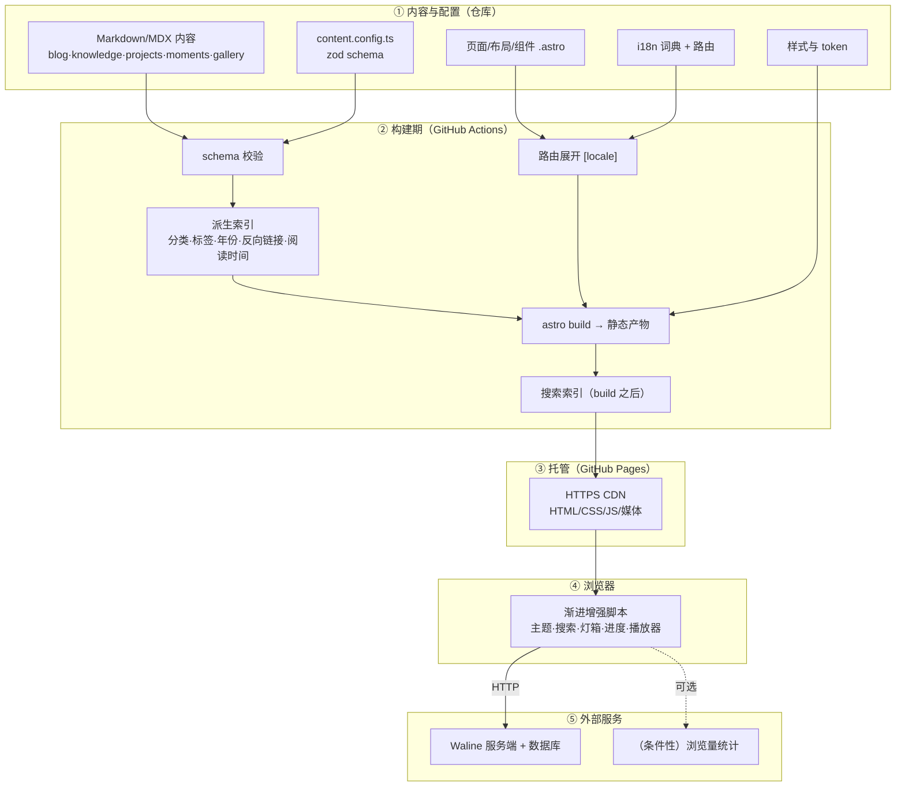

# 架构总地图（ARCHITECTURE.md）

> **用途**：一页看懂系统分层、执行环境边界、内容数据流、路由结构、部署链路与模块依赖。细节在各专题文档。
> **状态**：Confirmed（分层、静态托管、技术栈）+ Proposed（目录与实现方式）
> **更新**：2026-11-26
> **相关**：[架构索引](docs/architecture/index.md) · [系统总览](docs/architecture/system-overview.md) · [部署架构](docs/architecture/deployment-architecture.md) · [决策记录](docs/decisions/index.md) · [项目地图](docs/PROJECT_MAP.md)

## 1. 技术栈与形态

Astro（当前稳定版 7.4.13，要求 Node ≥ 22.23.4）· TypeScript · CSS/SCSS · Markdown/MDX · Content Collections · Waline（外部服务）· GitHub Actions · GitHub Pages。
**无服务端、无数据库、无前端框架**。产物是纯静态 HTML/CSS/JS/媒体文件。

## 2. 分层



依赖方向唯一：内容 → 构建 → 静态产物 → 浏览器。浏览器不读仓库、不连数据库；唯一外呼是评论与可选统计。

## 3. 执行环境归属（设计新功能时必须先归类）

| 环境 | 能做 | 不能做 | 承载的功能 |
| --- | --- | --- | --- |
| 构建期 | 读全仓内容、校验、聚合、生成文件 | 运行时长逻辑、写数据库 | 列表/聚合、TOC 数据、阅读时间、热力图、时间轴、反向链接、搜索索引、meta |
| 浏览器 | DOM、滚动、存储、请求静态资源 | 持久化跨用户数据 | 三态主题、搜索查询、灯箱、阅读进度、快捷键、播放器、视图切换、评论挂载 |
| 外部服务 | 写入、计数、鉴权 | 生成站点页面 | 评论、留言板、（条件性）浏览量/反应 |

判据：**需要写入并跨用户持久化 → 只能外部服务**；其余优先构建期。

## 4. 页面与内容领域

八个页面：Home、Blog、Projects、Knowledge、About、Gallery、Moments、Guestbook（+ 分类/标签聚合与 404）。
五个内容集合：`blog`、`knowledge`、`projects`、`moments`、`gallery`，按语言分目录存放。
四个内容方向（分类轴）：Tech / Life / Knowledge / Thought；分类可自由新增。

## 5. 内容数据流

```text
Markdown 文件（含 frontmatter）
  → Content Collections 加载（glob loader）
  → zod schema 校验（失败即构建失败）
  → 页面通过 getCollection / getEntry 取数
  → render(entry) 得到 Content 与 headings
  → 构建期派生：分类/标签/年份/反向链接/阅读时间/语言版本组
  → 路由展开 [locale] × 页面类型 → 静态 HTML
  → 产物内扫描生成搜索索引
```

禁止在仓库维护第二份分类/标签索引文件；所有派生数据都由内容算出。

## 6. 多语言路由结构

```text
/{locale}/                  Home
/{locale}/blog/...          Blog 列表与详情
/{locale}/projects/...      项目
/{locale}/knowledge/...     知识
/{locale}/gallery/...       图集
/{locale}/moments/...       动态
/{locale}/about/            About
/{locale}/guestbook/        留言板
/{locale}/categories|tags/  聚合
```

`{locale}` ∈ `zh-CN | zh-TW | en | ja`。默认语言是否带前缀**未定**（[风险 R-03](docs/risks-and-validation.md)）。
内容页只在其所属语言下生成；语言切换仅在有真实版本时可用。Waline 日语值映射为 `jp`。

## 7. 前端与外部服务的边界

| 功能 | 归属 | 边界规则 |
| --- | --- | --- |
| 评论 / 留言板 | Waline | 站点只挂客户端；`path` 与规范 URL 绑定；服务不可用时区块降级 |
| 浏览量 | 候选 Waline pageview | 未验证免费方案 → 完全不展示 |
| 反应/点赞 | 候选 Waline reaction | 默认弃用；弃用时不留任何残留 |
| 搜索 | 本站（构建期 + 浏览器） | 不走服务端 |
| 主题/视图偏好 | 浏览器 localStorage | 仅本机 |

## 8. 构建与部署链路

```text
push main → GitHub Actions
  → actions/checkout@v7
  → withastro/action@v6（安装 + build，Node 默认 24）
  → 搜索索引生成（必须在 build 之后）
  → actions/deploy-pages@v5
  → https://<user>.github.io/<repo>/
```

Pages 设置：Source = **GitHub Actions**；项目页需 `base: '/<repo>'`，且**所有站内链接带前缀**；自定义域名则移除 `base` 并使用 `public/CNAME`。

## 9. GitHub Pages 静态托管限制（影响架构的硬约束）

| 限制 | 数值 | 架构后果 |
| --- | --- | --- |
| 服务端 | 无 | 评论/统计必须外置 |
| 源仓库体积 | 建议 ≤1 GB | 媒体需预算与外置 |
| 发布站点 | ≤1 GB | 同上 |
| 带宽 | 软限制 100 GB/月 | 音频/大图克制 |
| 部署超时 | 10 分钟 | 构建不能过重 |
| 构建频率 | 软限制 10 次/小时（自定义 Actions 不受限） | 走 Actions 无此问题 |
| 计划要求 | 公开仓库可用（Free）；私有需 Pro/Team | 仓库可见性需先定 |

## 10. 模块依赖关系

| 模块 | 依赖 | 被依赖 |
| --- | --- | --- |
| 设计 token（styles） | 无 | 所有组件 |
| i18n（词典 + 路径工具） | 设计无 | 页面、导航、meta、Waline 配置 |
| 内容集合 + schema | 无 | 页面、派生索引、搜索 |
| 页面/布局 | token、i18n、内容 | 无（终端） |
| 客户端脚本 | token（CSS 变量）、公开配置 | 页面 |
| 搜索索引 | 内容 → 产物 | 搜索 UI |
| Waline 客户端 | i18n（语言映射）、主题（dark 选择器） | 文章页、留言板 |

原则：**依赖单向、无循环**；组件不反向读取全局内容或全局状态。

## 11. 想看更细的

[系统总览](docs/architecture/system-overview.md)（分层与归属表）· [前端架构](docs/architecture/frontend-architecture.md)（组件与脚本组织）· [路由与 i18n](docs/architecture/routing-and-i18n.md) · [内容架构](docs/architecture/content-architecture.md) · [数据模型](docs/architecture/data-models.md) · [部署架构](docs/architecture/deployment-architecture.md)
