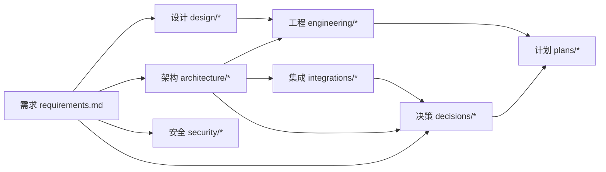

# 项目地图（总入口）

> **用途**：用一页回答"这是什么项目、有哪些领域、每个领域的权威文档在哪、怎么关联、从哪开始、哪些事还没定"。**任何 Agent 接手本项目都从这里开始。**
> **状态**：Confirmed（结构与已确认事实）+ 逐项标注的待定项
> **更新**：2026-11-26
> **相关**：[AGENTS.md](../AGENTS.md) · [ARCHITECTURE.md](../ARCHITECTURE.md) · [文档索引](./index.md) · [路线图](../plans/active/000-initial-implementation-roadmap.md) · [风险清单](./risks-and-validation.md)

## 1. 项目是什么

一个**简约文艺风格的多语言个人门户型博客**：四个内容方向（Tech / Life / Knowledge / Thought），八个页面（Home / Blog / Projects / Knowledge / About / Gallery / Moments / Guestbook），四种语言（`zh-CN` / `zh-TW` / `en` / `ja`），技术栈为 Astro + TypeScript + Markdown/MDX + Content Collections，托管在 GitHub Pages，评论用 Waline（独立外部服务）。默认不引入前端框架。

**当前阶段**：Phase 3 已完成 —— 设计系统、三态主题、四语言元信息与切换、语言感知 404 均已落地并有脚本校验；尚无内容模型与八大页面。

## 2. 领域与权威文档

| 领域 | 权威文档 | 一句话 |
| --- | --- | --- |
| 需求与范围 | [product/requirements.md](./product/requirements.md) | 唯一需求事实来源，含每条需求的状态 |
| 产品定位 | [product/product-overview.md](./product/product-overview.md) | 是什么、给谁、非目标 |
| 页面与导航 | [product/information-architecture.md](./product/information-architecture.md) | 页面层级、URL、语言切换语义 |
| 功能行为 | [product/feature-specifications.md](./product/feature-specifications.md) | 21 个功能的行为与验收 |
| 视觉方向 | [design/design-principles.md](./design/design-principles.md) | 为什么这样设计、反模式 |
| 设计数值 | [design/design-system.md](./design/design-system.md) | token、断点、组件清单（唯一数值来源） |
| 排版 | [design/typography.md](./design/typography.md) | 字体策略与中英混排 |
| 配色与主题 | [design/color-and-theme.md](./design/color-and-theme.md) | 黑白灰灰阶、三态主题 |
| 交互 | [design/interaction-guidelines.md](./design/interaction-guidelines.md) | 动效、键盘、焦点、降级 |
| 系统分层 | [architecture/system-overview.md](./architecture/system-overview.md) | 构建期/浏览器/外部服务三分类 |
| 前端结构 | [architecture/frontend-architecture.md](./architecture/frontend-architecture.md) | 零框架下的页面与脚本组织 |
| 路由与多语言 | [architecture/routing-and-i18n.md](./architecture/routing-and-i18n.md) | URL、前缀、语言切换、回退 |
| 内容系统 | [architecture/content-architecture.md](./architecture/content-architecture.md) | 集合划分、派生索引 |
| 字段定义 | [architecture/data-models.md](./architecture/data-models.md) | frontmatter 唯一权威定义 |
| 部署 | [architecture/deployment-architecture.md](./architecture/deployment-architecture.md) | `base`、域名、平台限制 |
| 工程规范 | [engineering/coding-standards.md](./engineering/coding-standards.md) | 编码约定 |
| 目录结构 | [engineering/project-structure.md](./engineering/project-structure.md) | 目标结构与新增文件判断 |
| 验收方式 | [engineering/testing-strategy.md](./engineering/testing-strategy.md) | 分层检查与发布冒烟 |
| 评论 | [integrations/waline.md](./integrations/waline.md) | 路径契约、多语言、服务端选型 |
| 统计 | [integrations/analytics.md](./integrations/analytics.md) | 浏览量/点赞的条件性规则 |
| 搜索 | [integrations/search.md](./integrations/search.md) | 构建期索引 + 浏览器查询 |
| PWA | [integrations/pwa.md](./integrations/pwa.md) | 缓存与更新冲突 |
| 媒体 | [integrations/media-storage.md](./integrations/media-storage.md) | 体积预算与存放策略 |
| 隐私 | [security/privacy.md](./security/privacy.md) | 禁止项与发布前清单 |
| 安全基线 | [security/security-baseline.md](./security/security-baseline.md) | 密钥、外链、依赖、CSP |
| 决策 | [decisions/index.md](./decisions/index.md) | 7 份 ADR：为什么这样选 |
| 外部事实 | [references/index.md](./references/index.md) | 官方链接与核验日期 |
| 执行计划 | [../plans/active/000-initial-implementation-roadmap.md](../plans/active/000-initial-implementation-roadmap.md) | 12 阶段与门禁 |
| 技术债 | [../plans/tech-debt.md](../plans/tech-debt.md) | 20 条跟踪项 |

## 3. 领域之间怎么关联

规则：

1. **需求是根**：不允许实现需求里没有的东西；不允许把 `Proposed` 当 `Confirmed`。
2. **决策记录约束架构**：与 ADR 冲突的实现视为错误，先改 ADR。
3. **设计数值只在 design-system.md**，其余文档引用而不复制。
4. **执行计划引用文档，不重复文档内容**。

## 4. 开发任务从哪里开始

1. 读 [AGENTS.md](../AGENTS.md)（地图）→ 读本文件（总览）。
2. 查 [风险清单](./risks-and-validation.md) 的 P0 项：**站点名、仓库名/`base`、语言前缀、尾斜杠策略、仓库可见性**必须先定案。
3. 进入 [路线图](../plans/active/000-initial-implementation-roadmap.md) 的第一个未完成阶段。
4. 开工前按任务类型补读对应权威文档；结束时同步更新文档与 [技术债](../plans/tech-debt.md)。

**不要**：跳过阶段、提前写页面、引入前端框架、把未验证的服务写成定论。

## 5. 哪些技术事项尚未确认

完整清单见 [风险与待验证](./risks-and-validation.md)，摘要：

| 类别 | 未确认项 |
| --- | --- |
| 不可逆前置 | 已全部定案：站点名 `The Commons`、仓库 `personal-blog`、`base`、语言前缀、尾斜杠策略 |
| 外部服务 | Waline 服务端与数据库选型、浏览量方案、点赞（Waline `reaction` 是否等价） |
| 实现方案 | 搜索（Pagefind 候选）、中文字体加载策略、高清图外置存储、音乐体积、双向链接语法、"高级标签"语义 |
| 平台能力 | 自定义响应头/CSP、单文件大小上限、旧 SW 自注销 |
| 质量 | 对比度实测、性能阈值、站内链接检查工具 |

## 6. 一句话给下一个 Agent

> 先读本文与 AGENTS.md；需求只信 `product/requirements.md`；数值只信 `design/design-system.md`；事实只信 `references/`；取舍只信 `decisions/`；做之前看 `risks-and-validation.md` 的 P0，做完更新文档与 `plans/tech-debt.md`。
