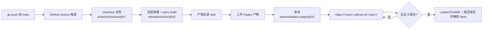

# 部署架构

> **用途**：说明构建、发布、域名与路径的完整链路，以及 GitHub Pages 的硬限制如何约束本站设计。改构建配置、发布流程、`base`、域名前必读。
> **状态**：Confirmed（GitHub Pages + Actions）+ Proposed（工作流细节）+ Needs Validation（仓库名与 `base`）
> **更新**：2026-11-26
> **相关**：[系统总览](./system-overview.md) · [路由与 i18n](./routing-and-i18n.md) · [构建与部署](../engineering/build-and-deployment.md) · [ADR-0002](../decisions/0002-github-pages-hosting.md) · [GitHub Pages 参考](../references/github-pages-and-actions.md)

## 1. 链路

上述 Action 名称与主版本、以及"Pages Source 必须选 **GitHub Actions**"这一设置，均来自 Astro 官方 GitHub Pages 部署指南（核验日期 2026-11-26）。实际落地时以官方文档当日内容为准，不在本文写死 YAML 全文。

## 2. 路径与域名（最容易出错的地方）

| 场景 | `site` | `base` | 站内链接 |
| --- | --- | --- | --- |
| 项目页（默认） | `https://<user>.github.io` | `/my-repo` | **全部必须带 base 前缀** |
| 用户页（`<user>.github.io` 仓库） | `https://<user>.github.io` | 不设 | 不带前缀 |
| 自定义域名 | `https://example.com` | **移除** | 去掉 base 前缀 |

配置了 `base` 却不给内链加前缀，会造成全站 404；反之去掉 `base` 后残留前缀，同样 404。因此：

- **当前仓库**：`ashtondebug/personal-blog`（Public，2026-11-26 定案），因此 `site = 'https://ashtondebug.github.io'`、`base = '/personal-blog'`。
- 站内链接一律由框架/工具函数生成（见 [路由与 i18n](./routing-and-i18n.md) 与 [前端架构 §5](./frontend-architecture.md)）。
- 仓库名 = `base` 值，两者必须一致；仓库名一旦改动，所有已分享链接与 Waline `path` 全部失效 → 这是 [技术债](../../plans/tech-debt.md) 中优先级最高的未定项之一。
- 自定义域名切换是一次性迁移：改 `site`、删 `base`、加 `public/CNAME`、更新所有外链与 OG URL，并考虑旧路径重定向（`Needs Validation`）。

## 3. GitHub Pages 硬限制（官方核验，2026-11-26）

| 限制 | 数值 | 对本站的影响 |
| --- | --- | --- |
| 计划要求 | 公开仓库可用（GitHub Free）；私有仓库发布 Pages 需 Pro/Team/Enterprise | 仓库可见性必须先确认，否则发布不可用 |
| 源仓库体积 | 建议 ≤ 1 GB | 音乐与高清图必须控制，见 [媒体存储](../integrations/media-storage.md) |
| 发布站点体积 | ≤ 1 GB | 构建产物 + 媒体总量 |
| 部署超时 | 10 分钟 | 图片优化/大媒体会拖长时间，需监控构建耗时 |
| 带宽 | 软限制 100 GB/月 | 大图/音频被频繁加载会逼近上限 |
| 构建频率 | 软限制 10 次/小时；**使用自定义 Actions 工作流时不受此限** | 本项目走 Actions，不受该限 |
| 服务端能力 | 无（纯静态托管） | 评论/统计必须外置，见 [ADR-0007](../decisions/0007-static-dynamic-service-boundary.md) |
| HTTPS | 对 `*.github.io` 默认可用 | 满足 PWA 的安全上下文要求 |

## 4. 构建步骤顺序（有前后依赖）

1. 安装依赖（lockfile 决定版本，**lockfile 必须入库**，官方说明该 Action 依赖它探测包管理器）。
2. 校验内容集合（schema 失败即中断）。
3. `astro build` 生成页面与资源到产物目录。
4. **搜索索引必须在构建产物之后生成**（索引读取最终 HTML）。
5. 上传并发布。

第 5 步与新功能无关，属于"每次发布都跑"的固定流程。

## 5. 缓存与更新

- HTML 应短期缓存或每次校验；带哈希的静态资源可长期缓存（具体头部由 GitHub Pages 决定，本站不做自定义头部 —— `Needs Validation`：Pages 是否允许自定义响应头）。
- Service Worker（PWA）是唯一能"自己决定缓存"的地方，因此它既是离线能力来源，也是"用户看到旧内容"的风险来源，见 [PWA](../integrations/pwa.md)。
- 发布后必须验证：首页、任一文章、搜索、评论区四条路径（见 [测试策略](../engineering/testing-strategy.md)）。

## 6. 失败模式与处置

| 现象 | 可能原因 | 处置顺序 |
| --- | --- | --- |
| 全站 404（样式/图片丢失） | `base` 配置与内链前缀不一致 | 先查 `base`，再查资源引用 |
| 部分页面 404 | 语言路由未生成该页 | 查 `getStaticPaths` 是否覆盖四种语言 |
| 部署成功但页面旧 | 缓存或 SW 缓存 | 先清 SW，再查发布产物 |
| 构建超时 | 图片优化或大媒体 | 拆分媒体源、改为外置存储 |
| 评论全部消失 | URL 变更导致 Waline `path` 变化 | 查路径变更记录，必要时迁移评论 |

## 7. 上线前必须定案的三件事

1. 仓库名（决定 `base`）。
2. 仓库可见性（决定 Pages 是否可用；Free 计划下需公开）。
3. 默认语言是否带前缀（决定全站 URL 与评论 key）。

三项都会写进 [技术债](../../plans/tech-debt.md)，未定案前不得部署到生产路径。
