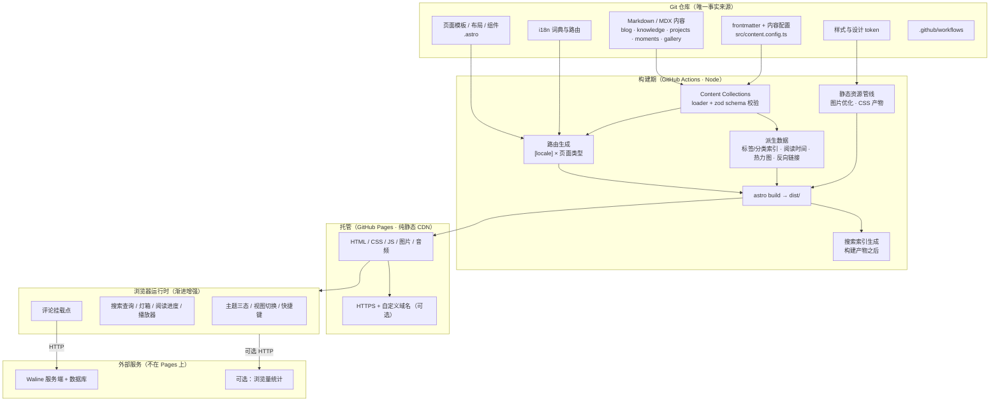

# 系统总览

> **用途**：一张图 + 三张表说清整个系统：内容从哪儿来、在哪儿被处理、最终由谁提供、哪些功能必须依赖外部服务。新功能立项前必读。
> **状态**：Confirmed（分层与静态托管约束）+ Proposed（具体目录与工具选型）
> **更新**：2026-11-26
> **相关**：[架构索引](./index.md) · [前端架构](./frontend-architecture.md) · [部署架构](./deployment-architecture.md) · [内容架构](./content-architecture.md) · [ADR-0007](../decisions/0007-static-dynamic-service-boundary.md) · [Waline 集成](../integrations/waline.md)

## 1. 分层视图

**依赖方向只有一个**：内容与模板 → 构建 → 静态产物 → 浏览器。浏览器永不直接读仓库、永不直连数据库；唯一例外是评论与可选统计这类"外部服务"，它们由浏览器直接调用第三方 HTTP 接口。

## 2. 三种执行环境的能力对照

| 能力 | 构建期 | 浏览器 | 外部服务 |
| --- | --- | --- | --- |
| 读取仓库全部内容 | ✅ | ❌ | ❌ |
| 校验 frontmatter | ✅ | ❌ | ❌ |
| 生成聚合页（分类/标签/年份） | ✅ | ❌ | ❌ |
| 计算阅读时间 / 热力图 / 反向链接 | ✅ | ❌ | ❌ |
| 生成搜索索引 | ✅（构建后一步） | 只查询 | ❌ |
| 读写 localStorage（主题等偏好） | ❌ | ✅ | ❌ |
| 持久化评论 | ❌ | 只提交 | ✅ |
| 计数浏览/反应 | ❌ | 只请求 | ✅ |

## 3. 功能归属表（每个已确认功能归到哪一类）

| 功能 | 构建期 | 浏览器 | 外部服务 | 边界说明 |
| --- | --- | --- | --- | --- |
| Blog / Knowledge / Projects / Moments / Gallery 列表与详情 | ✅ 全部生成 | — | — | 静态 HTML，无客户端数据请求 |
| 分类 / 标签聚合 | ✅ | — | — | 空分类不生成页面 |
| TOC | ✅ 生成数据 | 仅高亮与滚动 | — | 标题来自渲染期 `headings` |
| 阅读时间 | ✅ | — | — | 随内容一起输出，不新增手工字段 |
| 阅读进度 | — | ✅ | — | 纯滚动计算 |
| 全站搜索 | ✅ 建索引 | ✅ 查询 | — | 索引随构建产物发布 |
| 双向链接 / 关联推荐 | ✅ 解析与索引 | — | — | 悬空链接构建期报错 |
| 年度热力图 / 时间轴 | ✅ 统计 | 交互提示 | — | 零客户端请求 |
| 三种列表视图 | ✅ 数据 | ✅ 切换与持久化 | — | 同一数据集 |
| 主题三态 | — | ✅ | — | 首屏需内联初始化避免闪烁 |
| 快捷键 | — | ✅ | — | `/` 与 `Esc` |
| 音乐悬浮播放器 | — | ✅ | — | 音频为本地静态资源 |
| 评论 | — | ✅ 挂载 | ✅ Waline | Pages 无法运行后端 |
| 浏览量 | — | ✅ 请求 | ✅ 候选：Waline pageview | 条件性需求，未验证则不展示 |
| 点赞 | — | ✅ 请求 | ✅ 候选：Waline reaction | 默认弃用，未确认不得实现 |
| PWA | ✅ 产出 manifest 与 SW 文件 | ✅ 注册 | — | 缓存策略需谨慎 |
| SEO 元信息 | ✅ | — | — | 四语言各一套 |

## 4. 关键约束（设计任何方案前先过一遍）

1. **无服务端**：不存在 `prerender = false`、API 路由、SSR 适配器。任何需要数据库的功能都归外部服务。
2. **`base` 前缀**：项目页发布在 `/<repo>/` 下，站内链接与静态资源路径必须带框架提供的基路径，手拼绝对路径是常见 404 来源。
3. **内容即数据**：内容集合的 schema（zod）是主要质量防线，构建失败优于运行时错误。
4. **外部服务必须可降级**：Waline 不可用时页面必须仍可阅读，评论区显示降级文案。
5. **构建可复现**：lockfile 入库，Node 版本由工作流固定。

## 5. 与需求的状态同步

本文不定义新需求。每新增一类功能，必须：先在 [需求清单](../product/requirements.md) 登记 → 在本表归类 → 若引入外部服务则补 [集成文档](../integrations/index.md) 与 ADR。
