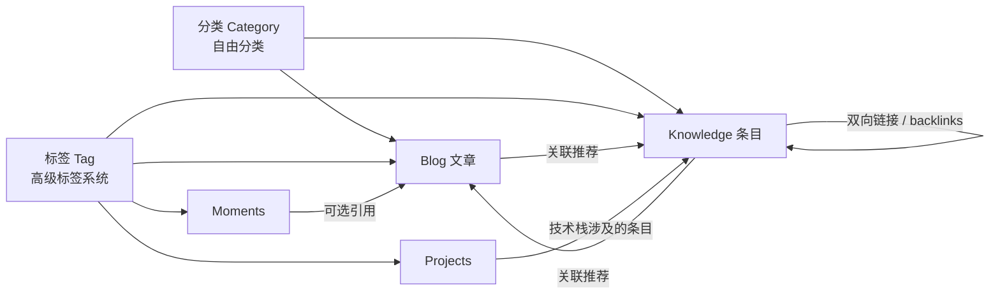

# 信息架构

> **用途**：定义页面层级、URL 结构、导航模型与内容之间的引用关系。做任何路由、菜单、内链相关工作时先读本文。
> **状态**：Confirmed（八大页面与语言策略）；URL 形式为 `Proposed`，待确认后转正。
> **更新**：2026-11-26
> **相关**：[需求清单 §2](./requirements.md) · [路由与 i18n](../architecture/routing-and-i18n.md) · [内容架构](../architecture/content-architecture.md) · [数据模型](../architecture/data-models.md)

## 1. 页面层级

```text
/{locale}/                      Home（极简个人主页）
├── blog/                       Blog 列表（三视图切换：列表 / 网格 / 杂志）
│   └── {slug}/                 文章详情（杂志式排版）
├── projects/                   项目列表
│   └── {slug}/                 项目详情
├── knowledge/                  Knowledge 根目录（层级目录 + 搜索入口）
│   └── {section}/{slug}/       知识条目（可多级）
├── about/                      关于
├── gallery/                    摄影杂志式图集
│   └── {slug}/                 单组作品 / 作品详情
├── moments/                    动态流（时间倒序）
│   └── {id}/                   单条动态独立链接
├── guestbook/                  独立留言板（独立 Waline path）
├── search/                     搜索结果页（也可作为浮层呈现）
├── categories/{category}/      分类聚合（自由分类）
└── tags/{tag}/                 标签聚合（高级标签系统）
```

约定：

- `{locale}` ∈ `zh-CN | zh-TW | en | ja`。
- 默认语言是否省略前缀（`/blog/` vs `/zh-CN/blog/`）**未定** 🔵，见 [REQ-I18N-07](./requirements.md) 与 [ADR-0004](../decisions/0004-per-language-articles.md)。
- 所有路径**末尾带斜杠**（`trailingSlash: 'always'`）待确认 🟡；一旦确定，Waline 的 `path` 标识必须与之锁定，不可中途漂移。

## 2. 导航模型

**全局主导航**（桌面：顶部横向；移动：抽屉/下拉）：

| 顺序 | 项 | 目标 |
| --- | --- | --- |
| 1 | Home | `/{locale}/` |
| 2 | Blog | `/{locale}/blog/` |
| 3 | Knowledge | `/{locale}/knowledge/` |
| 4 | Projects | `/{locale}/projects/` |
| 5 | Gallery | `/{locale}/gallery/` |
| 6 | Moments | `/{locale}/moments/` |
| 7 | About | `/{locale}/about/` |

**次级入口**：Guestbook（页脚 + About 内链）、Search（`/` 快捷键 + 图标）、主题切换（三态）、语言切换。

**Heatmap / Timeline 的位置**：年度热力图放在 Home（当前年份，跨集合统计）；简约时间轴放在 About（按年份分组的全部内容条目）。两者都是构建期渲染，不占独立路由。

> **现状（Phase 5）**：八个页面全部可点击（About 为占位页、Guestbook 待接入评论）。新增路由：`/{locale}/blog/page/{n}/`、`/{locale}/categories/{category}/`、`/{locale}/tags/{tag}/`，均已在 `scripts/check-i18n.mjs` 的版块列表内（分页与聚合页在有多篇内容时才会生成）。

**页脚**：站点简介、四大内容方向入口、Guestbook、RSS（是否提供未定 🔵）、版权与许可声明（未定 🔵）、Waline 服务状态说明。

## 3. 语言切换语义（关键约束）

| 当前页面类型 | 语言切换行为 |
| --- | --- |
| 站点级页面（Home/Blog 列表/Projects 列表/Gallery/Moments/About/Guestbook/搜索） | 切到目标语言的同一页面路径 |
| 内容页（文章/知识条目/项目/图集/动态） | **仅当该内容存在目标语言版本**时提供链接；否则不显示该语言选项，或显示为不可点击的"暂无此语言版本"提示 |

禁止行为：把不存在翻译的文章链接到同 slug 的其他语言（会产生 404 或错误内容）、自动机器翻译补位、生成伪 `hreflang`。

## 4. 内容关系图



规则：

1. **分类**是粗粒度主轴（Tech / Life / Knowledge / Thought 为初始值，但允许自由新增）。
2. **标签**是细粒度、可跨域的词条，需统一词表（别名合并、大小写与标点归一），具体语义 🔵 见 [REQ-CONTENT-10](./requirements.md)。
3. **双向链接**只在 Knowledge 内生效（`[[条目]]` 语法待定 🔵），构建期解析为反向链接索引。
4. **关联推荐**由标签/分类交集计算，构建期完成，不依赖客户端请求。

## 5. 三种列表视图

同一批数据、三种呈现，状态在客户端持久化（localStorage）`[Proposed]`：

| 视图 | 适用 | 特征 |
| --- | --- | --- |
| 列表 List | 快速扫读 | 单列、标题 + 摘要 + 元信息 |
| 网格 Grid | 浏览封面 | 等宽卡片、封面为主 |
| 杂志 Magazine | 强调编辑感 | 首条突出、大小错落、图文混排 |

视图切换只改变渲染，不改变 URL 与数据；默认视图未定 🔵。

## 6. 内部链接与可达性要求

- 任意内容页 **≤ 2 次点击**可从 Home 到达（Home → 列表 → 详情）。
- 每份文档、每个页脚、每个面包屑必须使用相对链接，禁止绝对 `http://localhost` 或生产域硬编码。
- 面包屑：`Home / 板块 / 分类 / 当前`。
- 站内链接不得依赖前端 JS 拦截（静态站需可被爬虫直接跟随）。

## 7. 待确认项（影响 URL 定案）

| 事项 | 影响 | 标记 |
| --- | --- | --- |
| 默认语言是否加前缀 | 全站 URL、Waline path、搜索索引、canonical | 🔵 |
| 仓库名与 `base` | 所有静态资源与内链前缀 | Confirmed：`personal-blog` / `/personal-blog`（2026-11-26） |
| Knowledge 层级深度上限 | 路由与目录组件复杂度 | 🟡 |
| 是否提供 RSS | 页脚与 SEO | 🔵 |
| 末尾斜杠策略 | 所有内链与评论 path | 🟡 |

上述任一项定案后，必须同步更新：[路由与 i18n](../architecture/routing-and-i18n.md)、[部署架构](../architecture/deployment-architecture.md)、[风险清单](../risks-and-validation.md)。
